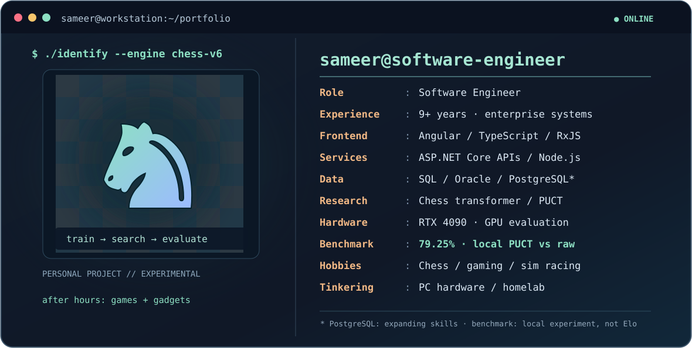

### Software Engineer · Enterprise Systems · Applied AI Research

**Angular / TypeScript** · **.NET / ASP.NET Core** · **Node.js / Express** · **SQL / Databases** · **Python / Chess AI**

[**Portfolio ↗**](https://sameer-kencham.github.io/) &nbsp; · &nbsp; [**Chess AI research ♞**](https://sameer-kencham.github.io/chess-ai.html) &nbsp; · &nbsp; [**Email ✉**](mailto:sameerkenchem@gmail.com)

---

## About me

I'm **Sameer Bharadwaj Kencham**, a software engineer building and maintaining enterprise applications in pharmacy operations, distribution, and aviation.

<!-- CAREER-SPAN:START -->
**Career span:** **9 years, 10 months, 1 day** · estimated start **January 10, 2017** · updated **November 11, 2026** (start day is an estimate, not a verified employment record).
<!-- CAREER-SPAN:END -->

My background is strongest in **Angular, TypeScript, RxJS, and NgRx**, and my work also spans **C#/.NET APIs, Node.js/Express, REST integration, and relational databases**. I'm actively developing deeper expertise in **PostgreSQL, SQL, and query optimization**. Outside of enterprise development, I also design, train, and evaluate **chess-playing AI models** as an independent research project.

### 🛠️ What I work with

| Area | Technologies & practices |
| --- | --- |
| **Frontend** | Angular, TypeScript, JavaScript, RxJS, NgRx, Angular Material, HTML, CSS/SCSS |
| **Backend & APIs** | C#, ASP.NET Core, Node.js, Express, REST APIs, async integration |
| **Data** | SQL, Oracle/PLSQL, PostgreSQL functions; currently deepening PostgreSQL performance skills |
| **Architecture & delivery** | Reusable components, micro-frontends, CI/CD, Azure DevOps, Jenkins, GitLab, Git |
| **Applied AI research** | Python, transformer models, QLoRA experiments, chess-state modeling, PUCT search, batched GPU inference, paired-match evaluation |

### 💼 Professional experience

- **Software Engineer — Walgreens ARxIS / ARxISNet** · Miracle Software Systems · **Dec 2023–present**  
  Enterprise pharmacy inventory applications; Angular/RxJS/NgRx, reusable components, ASP.NET Core API integration, PostgreSQL-backed workflows.
- **Software Developer — OMEGA, American Tire Distributors** · Miracle Software Systems · **Sep 2019–Nov 2023**  
  Order-management applications, Angular/NgRx, Node.js integrations, REST services, micro-frontends, Oracle/Solr data.
- **Senior UI Developer — Delta.com** · Delta Air Lines · **Jan–Jul 2019**  
  Customer-profile experiences, Angular, NgRx, Adobe Experience Manager, REST APIs, testing.
- **Senior UI Developer — SNAPP** · Delta Air Lines · **Feb 2018–Jan 2019**  
  Airport operations and passenger service workflows; legacy application modernization.
- **UI Developer** · Express Global Solutions LLC · **Jan 2017–Jan 2018**  
  Angular single-page applications, Node.js/Express services, NgRx and Webpack.

### 🔍 Engineering focus

- Design and improve **enterprise applications** across frontend, service, and data layers.
- Make **asynchronous workflows reliable** with clear state management, validation, and lifecycle ownership.
- Build **reusable components and APIs** that teams can maintain and extend.
- Keep learning: **PostgreSQL, SQL performance, backend architecture**, and developer productivity.

### ♞ Featured independent project — Training a chess-playing AI

I'm building a chess-playing AI system as a personal research and engineering project. It has evolved from Qwen3/QLoRA fine-tuning experiments into a purpose-built chess transformer with policy and win/draw/loss value predictions, improved through PUCT search.

- **Model engineering:** chess-specific state representations, action encoding, supervised data pipelines, and iterating on the architecture.
- **Search + inference:** batched GPU model evaluation and PUCT-guided move selection.
- **Experiment discipline:** reproducible opponents and search budgets, game-disjoint holdouts, and paired matches between candidate versions.
- **Recorded local result:** a PUCT64 configuration with twofold handling scored **79.25%** against its raw-policy comparator in a 100-pair evaluation; another version comparison finished at **52.5%**. These are internal benchmark scores, **not** official ratings or claims of state-of-the-art performance.

**[Read the full chess AI case study →](https://sameer-kencham.github.io/chess-ai.html)**

The project is still in development. Its model weights, private training files, and engine code are not represented as publicly released.

### 📌 Public work

I'm preparing original demos and sanitized engineering case studies. Professional systems described above are private employer/client projects; their source code is **not** public here.

### 🎮 Beyond the code

I enjoy projects where curiosity turns into something I can actually build or experiment with:

- **♟️ Chess & strategy:** Exploring chess positions and training my own chess-playing AI models.
- **🎮 Gaming & sim racing:** Enjoying games and tweaking settings to get the best experience.
- **🖥️ PC hardware & performance:** Tinkering with GPUs, displays, cooling/performance settings, and local AI setups.
- **🏠 Home lab & self-hosting:** Running a Mac mini server, media streaming, remote access, and connected devices.

A lot of my side projects start with **"what happens if I build it myself?"**

### 🤝 Connect

- [Portfolio website](https://sameer-kencham.github.io/)
- [Chess AI research case study](https://sameer-kencham.github.io/chess-ai.html)
- [GitHub](https://github.com/sameer-kencham)
- [Email](mailto:sameerkenchem@gmail.com)

*Interested in maintainable software, thoughtful design, and solving the bugs that don't fit neatly into one layer.*